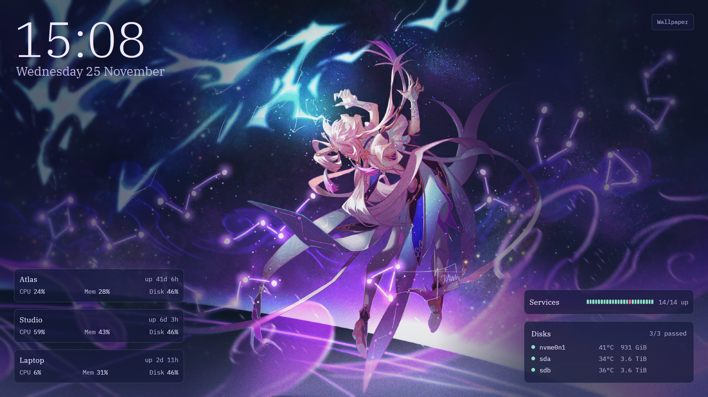
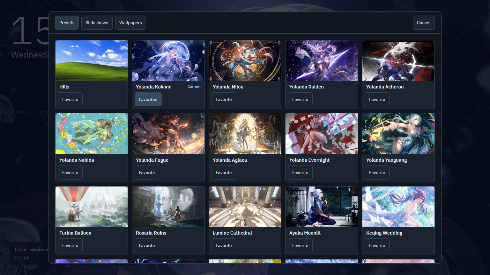

# SK Status Display

SK Status Display is a GPUI dashboard for a monitor or a spare computer. It shows the time, local system metrics, and remote sources that you configure. A fresh profile starts with a solid background and one card named **This machine**.

## Screenshots

These screenshots show example hosts, services, and disk readings. See [WALLPAPERS.md](WALLPAPERS.md) for the artists and sources.




The wallpaper menu has tabs for presets, slideshows, and imported images.




## Quick start

1. Download the executable for your device from the [GitHub releases](https://github.com/therealsamyak/server-status-display/releases).
2. Run the executable.
3. If you want more than local metrics, copy [config.example.toml](config.example.toml) to the configuration path for your OS and edit it.

## Configure a LAN-only display

Copy [config.lan.example.toml](config.lan.example.toml) to a separate profile directory. Replace
the example URLs and status page slug with your approved LAN routes. Remove the blocks for
unavailable services. Start the app with `--config` and the path to the new file.

Use one Glances host block for each machine that serves metrics on the LAN. The example has
separate addresses for a server and a workstation. A shared LAN can carry this traffic during
an internet outage if the display's policy permits the connection and the service listens on
an address the display can reach. A loopback-only or Tailscale-only listener needs a separate
approved LAN route.

Set `direct_metrics_http = true` before the first table. Glances, Kuma, and Scrutiny then ignore
proxy environment variables and reject HTTP redirects. Use each service's final base URL.
Use an approved, stable LAN IPv4 address when the display has no DNS access. For HTTPS, the
certificate must be trusted by the app and match the configured address or name. A name must
resolve locally when public DNS is unavailable. The operating system controls which routes are
allowed.

From the display, check that each configured route returns a successful JSON response without
following redirects. For example, use `curl.exe --noproxy "*" --max-time 5` on Windows.

| Source | Direct routes the app reads |
| --- | --- |
| Glances | `GET /api/4/cpu` and `GET /api/4/mem` are required. `load`, `sensors`, `fs`, `uptime`, `percpu`, and `network` under `/api/4/` supply optional readings. |
| Uptime Kuma | `GET /api/status-page/<slug>` and `GET /api/status-page/heartbeat/<slug>`. Use a status page that the display can read without signing in. |
| Scrutiny | `GET /api/summary`. The display connects to the web API. |
| In-app btop | Set `show_btop = true` on a Glances host to reuse its metrics feed. This opens no additional connection. |

Local metrics, the clock, and local wallpaper playback work without a network route. The
version button checks for updates and needs internet access to GitHub. Kuma reports the
server's view of its monitors, so public checks may fail during an internet outage even
while the display can read Kuma over the LAN.

Tailscale cards and the Tailnet panel are optional. They can show offline or unavailable
while direct feeds keep updating. Leave out Glances `fallback_device` for LAN hosts when
you want their cards to reflect only Glances availability.

Use an existing approved LAN route when it serves the required JSON. If the policy permits only
one server and a required API is reachable only from that server, first verify both paths. Check
that the display can reach the approved server and that the server can read the upstream API.
If the display still needs the feed, a separately approved reverse proxy can expose only the
required GET paths to the display on that server's LAN interface. If live upstream requests
cannot work, a periodically refreshed snapshot is an option when the server can collect the
data and delayed readings are acceptable. Keep the snapshot timestamp visible to its consumers.

Run `cargo test --locked status_lan_tests` to exercise the profile with loopback HTTP fixtures.
The fixtures cover all three APIs, Tailnet failure, redirects, and recovery after one host drops.
After the Windows policy is active, verify both hosts and the required service routes from a
temporary profile. Check that local metrics and wallpaper playback continue when a feed drops.

The executable starts fullscreen by default. Pass `--windowed` to start in a window. Pass `--display auto`, `--display primary`, or `--display 2` to select a monitor. The default is `auto`.

## Configure hosts and services

The app reads these optional sources:

| Panel | Source | What it shows |
| --- | --- | --- |
| Host | Glances | CPU, memory, disk, network, temperature, load, and uptime. |
| Host | Tailscale | Online state, last seen, OS, and network path. |
| Services | Uptime Kuma | Public status-page checks and uptime. |
| Disks | Scrutiny | SMART health, temperature, and power-on hours. |
| Tailnet | Tailscale | Every device in your tailnet. |

The app makes read-only requests only. It stores no credentials.

Set one `[[host]]` block for each card. Use `source = "glances"` with a `url`, `source = "tailscale"` with a `device`, or `source = "local"` for the machine that runs the display. Set `show_btop = true` on Glances hosts that should show the in-app btop window. Then enable Uptime Kuma, Scrutiny, or the Tailscale device list as needed.

The clock shows battery percentage and power state for the computer running the display.
The app detects this automatically on Windows, macOS, and Linux with UPower.
It reads local power status even when the network is offline.

Configuration paths:

| OS | Path |
| --- | --- |
| Windows | `%APPDATA%\server-status-display\config.toml` |
| macOS | `~/Library/Application Support/server-status-display/config.toml` |
| Linux | `~/.config/server-status-display/config.toml` |

See [WALLPAPERS.md](WALLPAPERS.md) for the artwork source list. See [config.example.toml](config.example.toml) for all fields.

## Build from source

Install the Rust toolchain from [rust-toolchain.toml](rust-toolchain.toml). Then run:

```sh
cargo run --release
```

The first build compiles GPUI from source and takes several minutes. Linux also needs the system libraries from the [Zed build guide](https://zed.dev/docs/development/linux). The app supports Windows, Linux, and Apple Silicon Macs.

## Basic controls

| Key | Action |
| --- | --- |
| F11 | Enter or leave fullscreen. |
| Escape | Close the picker or collapse an expanded card. Otherwise, leave fullscreen. |
| D | Move to the next display. |
| R | Reload the active configuration and refresh its sources. |
| Ctrl+Q or Cmd+Q | Quit. |

Move the pointer near the top-center display selector or the top-right toolbar to show both.
They stay open while the pointer is over either control or the space between them.
Select the display label to cycle through monitors.
Select **Refresh** to apply edits to the active configuration
in the same window. If the new configuration is invalid, the display keeps the previous settings
and shows an alert. Select **Wallpaper** to open the picker.
Select **Stay awake** to block idle sleep until you select **Allow sleep** or quit.
Open the local host card for system metrics, net battery power, and an estimate of battery time left when available.

## License

This project is licensed under the [GNU Affero General Public License v3.0](LICENSE.md). The bundled IBM Plex fonts are licensed under the SIL Open Font License.
