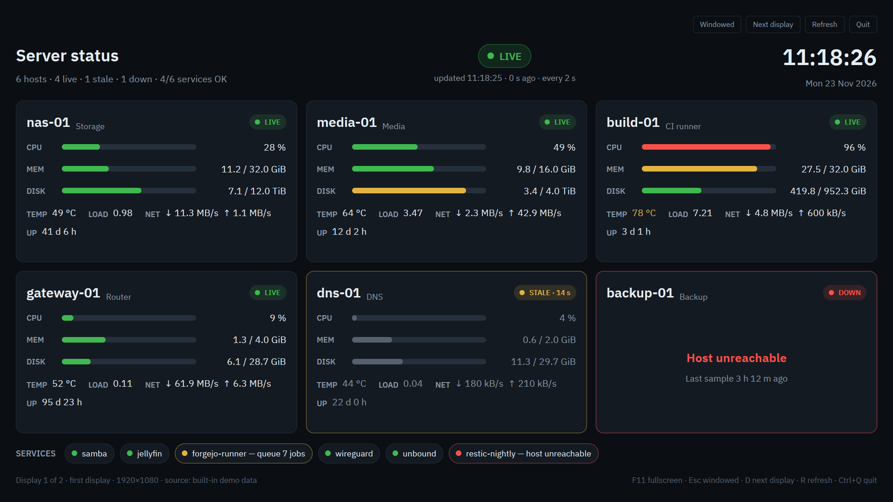

# Server status display

Server status display is a full-screen, continuously updating status board. It runs on the physical
monitor of a Windows laptop while Sunshine streams a game from a separate virtual display to
Moonlight. It uses [GPUI](https://github.com/zed-industries/zed/tree/6501df15765d66d6c2a2b66b1eb22434ccef3f86/crates/gpui),
the UI framework of the Zed editor. Windows is the priority platform. The same code builds for macOS
and Linux.

This repository holds a working first version and its design. The design states which behavior the
GPUI source supports and which behavior needs a hands-on test.



## Run the status display

You need the Rust toolchain in `rust-toolchain.toml`. GPUI comes from Git at Zed commit
`6501df15765d66d6c2a2b66b1eb22434ccef3f86`. The first build compiles GPUI and takes several minutes.

To show the built-in demo data, run this command:

```sh
cargo run --release
```

To poll a real status endpoint every 2 seconds, run this command:

```sh
cargo run --release -- --source http://status.example.internal:9100/status.json
```

The command-line options are:

| Option | Default | Effect |
| --- | --- | --- |
| `--source <URL or demo>` | `demo` | Polls a status snapshot URL, or shows built-in demo data. |
| `--interval <seconds>` | `2` | Sets the time between two polls. Freshness limits follow this value. |
| `--display <auto, primary, or N>` | `auto` | Selects the monitor. See [Display selection](#display-selection). |
| `--windowed` | off | Opens a normal window instead of fullscreen. |
| `--allow-focus` | off | Windows only. Lets a click give the status window keyboard focus. |
| `--demo-scenario <healthy or mixed>` | `mixed` | Selects the demo data. `mixed` has one stale host, one down host, and one degraded service. |
| `--demo-outage-after <seconds>` | none | Makes demo polls fail after this time. Use it to see the stale and offline states. |

The keyboard shortcuts work only when the status window has keyboard focus:

| Key | Action |
| --- | --- |
| `F11` | Enter or leave fullscreen. |
| `Esc` | Leave fullscreen. The window stays open on the same display. |
| `D` | Move the window to the next display. |
| `R` | Poll the status source now. |
| `Ctrl+Q` (macOS: `Cmd+Q`) | Quit. |

The header also has `Fullscreen` or `Windowed`, `Next display`, `Refresh`, and `Quit` buttons. On
Windows, these buttons are the main controls, because the window does not take keyboard focus by
default.

## Status snapshot contract

The display polls one URL. The URL returns one JSON document in this format:

```json
{
  "generated_at": "2026-11-23T22:02:11Z",
  "hosts": [
    {
      "name": "nas-01",
      "role": "Storage",
      "reachable": true,
      "sampled_at": "2026-11-23T22:02:10Z",
      "uptime_seconds": 3564000,
      "cpu_percent": 23.0,
      "memory_used_bytes": 12025908428,
      "memory_total_bytes": 34359738368,
      "disk_used_bytes": 7806532617830,
      "disk_total_bytes": 13194139533312,
      "temperature_celsius": 48.0,
      "load_1m": 0.82,
      "network_rx_bytes_per_second": 12400000,
      "network_tx_bytes_per_second": 1100000
    }
  ],
  "services": [
    { "name": "samba", "host": "nas-01", "state": "ok" },
    { "name": "restic-nightly", "host": "backup-01", "state": "down", "detail": "host unreachable" }
  ]
}
```

The rules for the contract are:

- `generated_at` and `sampled_at` are RFC 3339 times.
- All metric fields are optional. The display shows `—` for a missing value.
- `reachable: false` means the status source cannot reach the host.
- `state` is `ok`, `degraded`, or `down`.
- Host and service order in the JSON is the display order.

This version does not include a collector. A small aggregator, a Prometheus query adapter, or a
Glances adapter can produce this document. See [Open questions](#open-questions).

## Design

### Goals

The status display must do these things:

- Fill the physical laptop monitor and update without user action.
- Never take keyboard input away from the game that Sunshine streams.
- Show clearly when data is old or missing. Old numbers must never look current.
- Stay on the physical monitor when the virtual display appears, disappears, or becomes primary.
- Build from one code base for Windows, macOS, and Linux.

### Screen layout

The layout fills the window and scales from a 1600-pixel reference width. The wireframe shows a
1920 × 1080 display with the `mixed` demo data:

```text
┌──────────────────────────────────────────────────────────────────────────────────────────────┐
│                                                [Windowed] [Next display] [Refresh] [Quit]    │
│ Server status                                    ( ● LIVE )                       14:02:11   │
│ 6 hosts · 4 live · 1 stale · 1 down · 4/6 OK   updated 14:02:11 · 0 s ago   Mon 23 Nov 2026  │
│ ┌ ● ALERT (only when needed): keyboard focus / source stale / source offline ──────────────┐ │
│ └───────────────────────────────────────────────────────────────────────────────────────────┘ │
│ ┌ nas-01  Storage ───── ● LIVE ┐ ┌ media-01  Media ──── ● LIVE ┐ ┌ build-01  CI runner ● LIVE ┐ │
│ │ CPU  ████░░░░░░░░    23 %    │ │ CPU  ████████░░░░    61 %   │ │ CPU  ███████████░    88 %  │ │
│ │ MEM  ████░░░░░░  11.2/32 GiB │ │ MEM  ██████████░  9.8/16 GiB│ │ MEM  ███████████ 27.5/32 GiB│ │
│ │ DISK ███████░░░ 7.1/12.0 TiB │ │ DISK ███████████ 3.4/4.0 TiB│ │ DISK ████░░░  0.4/0.9 TiB  │ │
│ │ TEMP 48 °C  LOAD 0.82        │ │ TEMP 67 °C  LOAD 3.41       │ │ TEMP 79 °C  LOAD 7.95      │ │
│ │ NET ↓ 12.4 MB/s ↑ 1.1 MB/s   │ │ NET ↓ 2.3 MB/s ↑ 38.6 MB/s  │ │ NET ↓ 4.8 MB/s ↑ 600 kB/s  │ │
│ │ UP 41 d 6 h                  │ │ UP 12 d 2 h                 │ │ UP 3 d 1 h                 │ │
│ └──────────────────────────────┘ └─────────────────────────────┘ └────────────────────────────┘ │
│ ┌ gateway-01  Router ── ● LIVE ┐ ┌ dns-01  DNS ─ ● STALE · 14 s┐ ┌ backup-01  Backup ── ● DOWN┐ │
│ │ CPU  █░░░░░░░░░░░     7 %    │ │ (values in gray)            │ │                            │ │
│ │ MEM  ███░░░░░░░  1.3/4.0 GiB │ │ CPU  ░░░░░░░░░░░░     3 %   │ │      Host unreachable      │ │
│ │ ...                          │ │ ...                         │ │  Last sample 3 h 12 m ago  │ │
│ └──────────────────────────────┘ └─────────────────────────────┘ └────────────────────────────┘ │
│ SERVICES ● samba ● jellyfin ▲ forgejo-runner — queue 7 jobs ● wireguard ● unbound ✖ restic-nightly │
│ Display 1 of 2 · built-in panel "Built-in Display" · 1920×1080 · source: …   F11 · Esc · D · R · Ctrl+Q │
└──────────────────────────────────────────────────────────────────────────────────────────────┘
```

The layout rules are:

- The header shows the source state pill, the last update, and a large clock. You can read the clock
  from across a room.
- Host cards use a 3-column grid for 5 or more hosts and a 2-column grid for 4 or fewer hosts.
- Bars are green below 75 %, amber from 75 %, and red from 90 %. Temperature is amber from 75 °C and
  red from 85 °C.
- Stale values are gray. A stale card has an amber border. A down or offline card shows the reason
  and the sample age instead of numbers.
- The footer holds only information that you do not need at a glance. On Windows, the taskbar can
  cover the bottom of the screen. See [Hands-on verification](#hands-on-verification).

The screenshots in [docs/screenshots](docs/screenshots) show each state:

| File | State |
| --- | --- |
| [00-two-display-simulation.png](docs/screenshots/00-two-display-simulation.png) | Two outputs. The status display is on output 1. A focused app on output 2 stands in for the game. |
| [01-live-mixed.png](docs/screenshots/01-live-mixed.png) | Live source with one stale host, one down host, and one degraded service. |
| [02-healthy.png](docs/screenshots/02-healthy.png) | All hosts and services healthy. |
| [03-focus-warning.png](docs/screenshots/03-focus-warning.png) | The status window has keyboard focus. |
| [04-source-stale.png](docs/screenshots/04-source-stale.png) | Source polls fail. Data is 12 seconds old. |
| [05-source-offline.png](docs/screenshots/05-source-offline.png) | Source polls fail for more than 30 seconds. |
| [06-small-display.png](docs/screenshots/06-small-display.png) | 1280 × 720 logical pixels, the size of a 1080p laptop panel at 150 % scale. |
| [07-windowed.png](docs/screenshots/07-windowed.png) | Windowed mode after `Esc`. |
| [08-http-source.png](docs/screenshots/08-http-source.png) | A real HTTP source with 3 hosts. Missing metrics show `—`. |

### Refresh, stale, and offline behavior

The display polls the status source on a background thread. A 1-second tick redraws the clock and the
age labels. The tick also starts a poll when the poll interval has passed. Only one poll runs at a
time. A slow source does not stack requests.

The freshness limits come from the poll interval. With the default 2-second interval, the limits are:

| Value | Rule | Default |
| --- | --- | --- |
| Request timeout | 75 % of the interval, from 0.5 s to 10 s | 1.5 s |
| Stale after | 3 missed polls | 6 s |
| Offline after | 15 missed polls, and at least 30 s | 30 s |

The source state uses the age of the last successful poll:

| Source state | Condition | Display |
| --- | --- | --- |
| `CONNECTING` | No successful poll yet, and less than 30 s since start. | Blue pill. "Waiting for the first status snapshot". |
| `LIVE` | Last success is less than 6 s old. | Green pill. Normal colors. |
| `STALE` | Last success is 6 s to 30 s old. | Amber pill and amber alert with the data age, the failed poll count, and the last error. All values are gray. Header says "Last known". |
| `OFFLINE` | Last success is 30 s or more old, or no success in the first 30 s. | Red pill and red alert. Cards show "no current data". Host names stay visible. |

Each host also has a state. The host state compares `sampled_at` with the snapshot `generated_at`,
so a clock difference between the status source and the laptop has no effect:

| Host state | Condition | Card |
| --- | --- | --- |
| `LIVE` | Sample age is less than 6 s. | Normal colors. |
| `STALE · 14 s` | Sample age is 6 s to 30 s. | Gray values and amber border. |
| `OFFLINE` | Sample age is 30 s or more. | "No recent sample" and the sample age. |
| `DOWN` | `reachable` is `false`. | "Host unreachable" and the sample age. |

The display polls again immediately after the system wakes from sleep. GPUI reports wake events
through `App::on_system_wake`
([app.rs#L1900-L1909](https://github.com/zed-industries/zed/blob/6501df15765d66d6c2a2b66b1eb22434ccef3f86/crates/gpui/src/app.rs#L1900-L1909)).

GPUI limits the frame rate of an inactive window to about 30 frames per second by default
([platform.rs#L2734-L2738](https://github.com/zed-industries/zed/blob/6501df15765d66d6c2a2b66b1eb22434ccef3f86/crates/gpui/src/platform.rs#L2734-L2738)).
The status window is inactive while you play. It redraws once per second, so this limit has no
visible effect.

### Keyboard focus

Keyboard focus is the main risk in this setup. Sunshine sends remote keyboard and mouse input to the
Windows foreground window. If the status window becomes the foreground window, the game stops
receiving input. The design prevents this in four ways:

1. The window opens with `WindowOptions::focus = false`. On Windows, GPUI then shows the window with
   `SW_SHOWNOACTIVATE`
   ([gpui_windows/src/window.rs#L580-L585](https://github.com/zed-industries/zed/blob/6501df15765d66d6c2a2b66b1eb22434ccef3f86/crates/gpui_windows/src/window.rs#L580-L585)).
2. The app never calls `Window::activate_window` or `App::activate`. On Windows,
   `activate_window` sends a synthetic Alt key press with `SendInput` before `SetForegroundWindow`
   ([gpui_windows/src/window.rs#L817-L868](https://github.com/zed-industries/zed/blob/6501df15765d66d6c2a2b66b1eb22434ccef3f86/crates/gpui_windows/src/window.rs#L817-L868)).
   During a stream, that key press can reach the game.
3. On Windows, the app adds `WS_EX_NOACTIVATE` to the window after GPUI creates it. GPUI has no
   option for this style. The app gets the `HWND` through GPUI's `HasWindowHandle` implementation
   ([window.rs#L8112](https://github.com/zed-industries/zed/blob/6501df15765d66d6c2a2b66b1eb22434ccef3f86/crates/gpui/src/window.rs#L8112)).
   With this style, a click on the window does not make it the foreground window. Use
   `--allow-focus` to turn this off.
4. When the window has keyboard focus, an amber alert says that remote input now goes to the status
   window. The view observes activation changes with `observe_window_activation`.

The trade-off of `WS_EX_NOACTIVATE` is that the keyboard shortcuts do not work in the default Windows
mode. The header buttons work with the mouse. Use them to leave fullscreen, change display, refresh,
or quit.

GPUI handles focus differently on each platform:

| Platform | `focus: false` at open | Source |
| --- | --- | --- |
| Windows | Supported. Shows with `SW_SHOWNOACTIVATE`. | [window.rs#L580-L585](https://github.com/zed-industries/zed/blob/6501df15765d66d6c2a2b66b1eb22434ccef3f86/crates/gpui_windows/src/window.rs#L580-L585) |
| macOS | Supported. Uses `orderFront` instead of `makeKeyAndOrderFront`. | [window.rs#L1370-L1375](https://github.com/zed-industries/zed/blob/6501df15765d66d6c2a2b66b1eb22434ccef3f86/crates/gpui_macos/src/window.rs#L1370-L1375) |
| Linux | Not supported. `WindowParams::focus` is dead code on Linux. The compositor decides. | [platform.rs#L2825-L2829](https://github.com/zed-industries/zed/blob/6501df15765d66d6c2a2b66b1eb22434ccef3f86/crates/gpui/src/platform.rs#L2825-L2829) |

On macOS, simple fullscreen calls `makeKeyAndOrderFront` when it enters or leaves
([gpui_macos/src/window.rs#L638-L646](https://github.com/zed-industries/zed/blob/6501df15765d66d6c2a2b66b1eb22434ccef3f86/crates/gpui_macos/src/window.rs#L638-L646)).
Native fullscreen moves the window to its own Space
([window.rs#L2031-L2042](https://github.com/zed-industries/zed/blob/6501df15765d66d6c2a2b66b1eb22434ccef3f86/crates/gpui_macos/src/window.rs#L2031-L2042)).
Both can take focus on macOS. The focus alert shows when this happens.

### Display selection

The `--display` option selects the monitor:

| Selector | Windows | macOS | Linux |
| --- | --- | --- | --- |
| `auto` (default) | The physical display. See the ranking below. | The primary display. | The primary display. Wayland reports none, so the first display. |
| `primary` | The display at the origin `(0, 0)`. | The display with the menu bar. | X11: the default X screen. Wayland: the first display. |
| `N` | The Nth display from left to right, then top to bottom. | Same. | Same. |

Windows `auto` does not use the Windows primary display. A virtual display setup can make the
virtual display primary while a stream runs. GPUI's Windows primary display is the monitor at point
`(0, 0)`
([gpui_windows/src/display.rs#L83-L96](https://github.com/zed-industries/zed/blob/6501df15765d66d6c2a2b66b1eb22434ccef3f86/crates/gpui_windows/src/display.rs#L83-L96)),
so it follows that change.

GPUI does not report the connector type or whether a display is virtual. The app reads this
information directly from Windows with `QueryDisplayConfig` and `DisplayConfigGetDeviceInfo`. Then
it ranks the active displays:

1. Built-in panel: internal, embedded DisplayPort, or embedded UDI output. The primary display wins a
   tie.
2. Primary external monitor on a physical connector, such as HDMI or DisplayPort.
3. Other external monitor.
4. Indirect wired display, such as a USB display adapter.
5. Never: indirect virtual output or unknown output. Virtual display drivers use these types.

The app maps the chosen Windows display to a GPUI display with the GDI device name, such as
`\\.\DISPLAY1`, and the `HMONITOR` handle. GPUI on Windows uses the `HMONITOR` value as the
`DisplayId`
([gpui_windows/src/display.rs#L79-L81](https://github.com/zed-industries/zed/blob/6501df15765d66d6c2a2b66b1eb22434ccef3f86/crates/gpui_windows/src/display.rs#L79-L81)).
This mapping is a GPUI implementation detail, not a public contract. If a GPUI update changes it,
`auto` uses the primary display, and the footer label shows "primary".

The footer shows the chosen display, its number, its kind, and its size. Use this label to confirm
the choice.

### Fullscreen and exit

The window opens with `WindowBounds::Fullscreen`. GPUI then calls the platform fullscreen toggle
after it creates the window
([window.rs#L1755-L1759](https://github.com/zed-industries/zed/blob/6501df15765d66d6c2a2b66b1eb22434ccef3f86/crates/gpui/src/window.rs#L1755-L1759)).
Each platform uses a different fullscreen type:

| Platform | Fullscreen type | Source |
| --- | --- | --- |
| Windows | Borderless window. GPUI removes the frame and sizes the window to the physical bounds of the display. It uses `SWP_NOACTIVATE`, so the toggle does not take focus. | [window.rs#L306-L366](https://github.com/zed-industries/zed/blob/6501df15765d66d6c2a2b66b1eb22434ccef3f86/crates/gpui_windows/src/window.rs#L306-L366) |
| macOS | Native fullscreen in a separate Space. `toggle_simple_fullscreen` is also available. | [window.rs#L2031-L2042](https://github.com/zed-industries/zed/blob/6501df15765d66d6c2a2b66b1eb22434ccef3f86/crates/gpui_macos/src/window.rs#L2031-L2042) |
| Linux Wayland | `xdg_toplevel.set_fullscreen(None)`. The compositor selects the output. | [wayland/window.rs#L1984-L1993](https://github.com/zed-industries/zed/blob/6501df15765d66d6c2a2b66b1eb22434ccef3f86/crates/gpui_linux/src/linux/wayland/window.rs#L1984-L1993) |
| Linux X11 | `_NET_WM_STATE_FULLSCREEN`. The window manager selects the monitor. | [x11/window.rs#L1716-L1725](https://github.com/zed-industries/zed/blob/6501df15765d66d6c2a2b66b1eb22434ccef3f86/crates/gpui_linux/src/linux/x11/window.rs#L1716-L1725) |

To leave fullscreen, do one of these things:

- Click `Windowed` in the header. This works in every mode.
- Press `Esc` or `F11` when the window has keyboard focus.

Leaving fullscreen does not quit the app. The window becomes a normal window at 80 % of the display
size. To quit, click `Quit`, press `Ctrl+Q` (macOS: `Cmd+Q`), or close the window.

### Monitor changes

The app subscribes to `App::observe_displays`. GPUI reports `Added`, `Removed`, and `Changed` events
([platform.rs#L123-L141](https://github.com/zed-industries/zed/blob/6501df15765d66d6c2a2b66b1eb22434ccef3f86/crates/gpui/src/platform.rs#L123-L141)).
The platform calls can be spurious
([platform.rs#L424-L428](https://github.com/zed-industries/zed/blob/6501df15765d66d6c2a2b66b1eb22434ccef3f86/crates/gpui/src/platform.rs#L424-L428)).

When a display event arrives, the app does these steps:

1. Waits 750 ms for more events. A Sunshine stream start can add a display, change the primary
   display, and change resolution in one burst.
2. Runs the display selection again.
3. Stops if the chosen display ID and bounds are the same as before.
4. Otherwise, reads the fullscreen state of the old window and opens a new window on the chosen
   display with the same state.
5. Closes the old window.

The app reopens the window instead of moving it. On Windows, GPUI stores the display bounds when the
window enters fullscreen
([window.rs#L342-L348](https://github.com/zed-industries/zed/blob/6501df15765d66d6c2a2b66b1eb22434ccef3f86/crates/gpui_windows/src/window.rs#L342-L348)).
A moved or resized fullscreen window can keep old bounds. A new window always uses the current bounds.
The status data does not reset, because the poll model lives outside the window.

On Windows, GPUI receives `WM_DISPLAYCHANGE` on a hidden top-level window, so display events arrive
with no window open
([gpui_windows/src/platform.rs#L213-L217](https://github.com/zed-industries/zed/blob/6501df15765d66d6c2a2b66b1eb22434ccef3f86/crates/gpui_windows/src/platform.rs#L213-L217)).
On macOS, GPUI uses the screen parameters notification
([gpui_macos/src/platform.rs#L1465-L1487](https://github.com/zed-industries/zed/blob/6501df15765d66d6c2a2b66b1eb22434ccef3f86/crates/gpui_macos/src/platform.rs#L1465-L1487)).
On Linux, the Wayland backend reports output changes. The X11 backend reports one display for the
whole X screen and has no RandR change handler in this GPUI revision
([x11/display.rs#L14-L36](https://github.com/zed-industries/zed/blob/6501df15765d66d6c2a2b66b1eb22434ccef3f86/crates/gpui_linux/src/linux/x11/display.rs#L14-L36)).

### Fonts

The app bundles IBM Plex Sans Regular and SemiBold in `assets/fonts/ibm-plex-sans` under the SIL
Open Font License. GPUI on Linux maps the system UI font to IBM Plex Sans, but a standalone app does
not have that font
([gpui_linux/src/linux/platform.rs#L132](https://github.com/zed-industries/zed/blob/6501df15765d66d6c2a2b66b1eb22434ccef3f86/crates/gpui_linux/src/linux/platform.rs#L132)).
The bundled font gives the same text on every platform.

### Module layout

Each module has one concern:

| File | Concern |
| --- | --- |
| `src/main.rs` | Command-line options, key bindings, and app start. |
| `src/status_snapshot.rs` | JSON contract types. |
| `src/status_source.rs` | HTTP polling with `ureq`, and the demo source switch. |
| `src/status_demo.rs` | Demo data and the simulated outage. |
| `src/status_freshness.rs` | Freshness limits and the source and host state rules. |
| `src/status_board.rs` | GPUI model: poll loop, latest snapshot, and errors. |
| `src/status_format.rs` | Number, size, rate, age, and clock text. |
| `src/status_fonts.rs` | Bundled IBM Plex Sans font registration. |
| `src/status_view.rs` | GPUI view: layout, alerts, buttons, and actions. |
| `src/status_window.rs` | Window open, fullscreen state, and monitor change handling. |
| `src/display_select.rs` | Display selectors and the physical display ranking. |
| `src/display_windows.rs` | Windows display configuration queries and `WS_EX_NOACTIVATE`. |

## Verification

### Verified in this version

These checks ran on Linux (KDE Plasma, Wayland) with GPUI at the pinned commit:

- `cargo test` passes 13 unit tests. The tests cover the JSON contract, the freshness rules, the
  formatting, the demo data, the display selectors, and the physical display ranking.
- `cargo clippy --all-targets` reports no warnings for Linux.
- `cargo clippy --all-targets --target x86_64-pc-windows-gnu` reports no warnings. This check
  compiles the Windows display and focus code against the `windows` crate and `gpui_windows`. It
  does not run the code. The check ran in a temporary copy with TLS turned off in `ureq`, because
  the `ring` crate needs a MinGW C compiler. It used `llvm-windres` for the GPUI manifest.
- The screenshots come from the app in a nested KWin Wayland session with two virtual outputs. The
  stale and offline screenshots use `--demo-outage-after`.
- The HTTP source polled a local JSON file through `http://127.0.0.1`. See `08-http-source.png`.
- On Wayland, a focused app on the second output leaves the status window inactive. The focus alert
  is hidden in that state and shows when the status window is focused.

### Hands-on verification

These items need a test on real hardware. Windows items come first:

1. **Windows display ranking.** Start a Sunshine stream with the virtual display. Confirm that the
   footer shows the built-in panel. Record the output technology that the virtual display driver
   reports. The ranking treats indirect virtual and unknown outputs as virtual.
2. **Windows primary display swap.** Start and stop a stream that makes the virtual display primary.
   Confirm that the status window stays on, or returns to, the physical panel within about 1 second.
3. **`HMONITOR` stability.** Confirm that GPUI `DisplayId` values match the `HMONITOR` values after a
   display change.
4. **`WS_EX_NOACTIVATE` with GPUI.** Click the status window during a stream. Confirm that the game
   keeps input and that the header buttons still work. Confirm that GPUI's DirectComposition
   renderer draws normally with this style.
5. **Taskbar overlap.** The status window is not the foreground window, so Windows can draw the
   taskbar over it. Check whether the taskbar covers the footer. If it does, use taskbar auto-hide or
   move the taskbar to another display.
6. **Sleep and lid.** Close and open the laptop lid during a stream. Confirm that the display
   recovers and the source state returns to `LIVE`.
7. **macOS fullscreen focus.** Confirm whether native fullscreen takes focus from the streamed app.
   If it does, test `toggle_simple_fullscreen`.
8. **Linux X11.** Confirm fullscreen placement with more than one monitor. GPUI X11 sees one display
   for the whole X screen.

## Open questions

- Which collector produces the status snapshot: a custom aggregator, Prometheus, or Glances?
- Must the app start at sign-in on the Windows laptop? This version adds no startup entry or
  service.
- Must the display move content over time to reduce image retention on an OLED panel?
