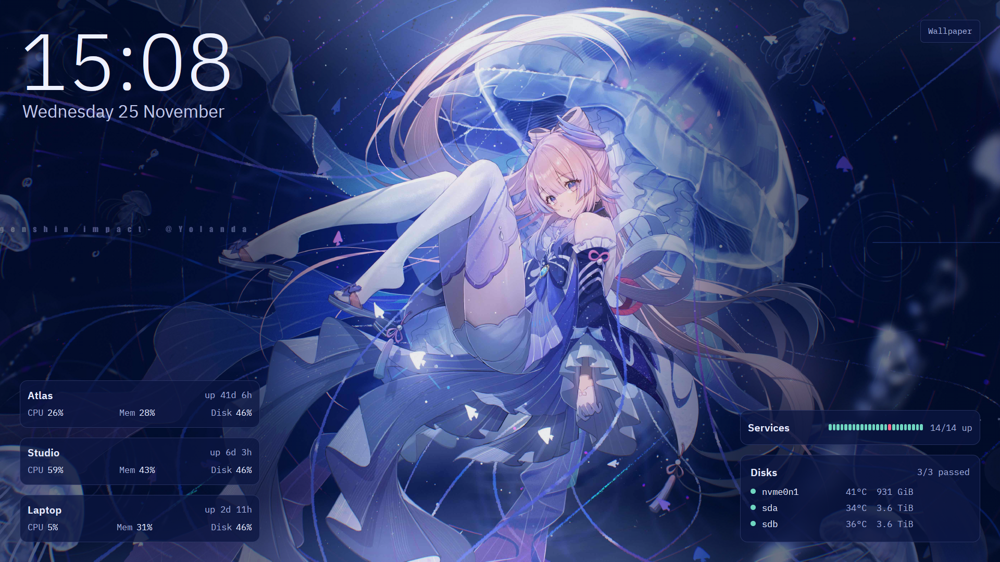
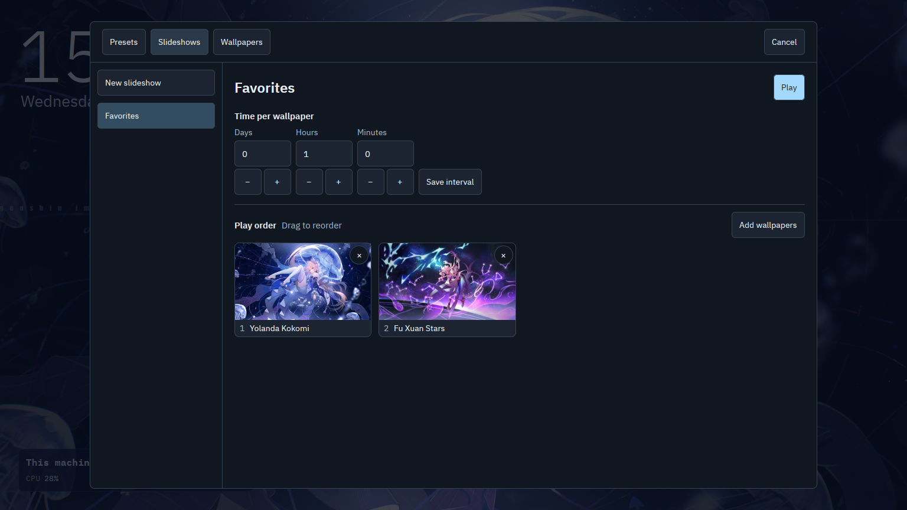
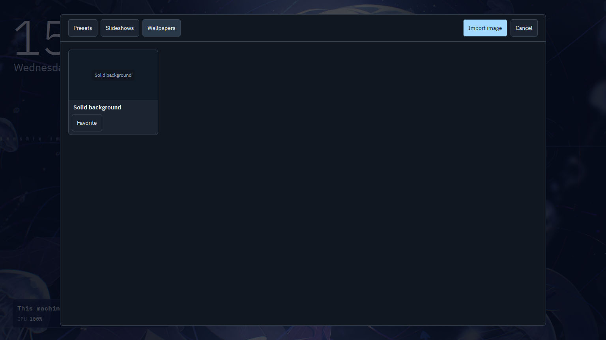

# SK Status Display

SK Status Display is a GPUI dashboard for a monitor or a spare computer. It shows the time, local system metrics, and remote sources that you configure. A fresh profile starts with a solid background and one card named **This machine**.

## Screenshots

These screenshots show example hosts, services, and disk readings. See [WALLPAPERS.md](WALLPAPERS.md) for the artists and sources.




The wallpaper menu has tabs for presets, slideshows, and imported images.






## Quick start

1. Download the executable for your device from the [GitHub releases](https://github.com/therealsamyak/server-status-display/releases).
2. Run the executable.
3. If you want more than local metrics, copy [config.example.toml](config.example.toml) to the configuration path for your OS and edit it.

The executable starts fullscreen by default. Pass `--windowed` to start in a window. Pass `--display auto`, `--display primary`, or `--display 2` to select a monitor. The default is `auto`.

## Configure hosts and services

The app reads these optional sources:

| Panel | Source | What it shows |
| --- | --- | --- |
| Host | Glances | CPU, memory, disk, network, temperature, load, and uptime. |
| Host | Tailscale | Online state, last seen, OS, and network path. |
| Services | Uptime Kuma | Public status-page checks and uptime. |
| Disks | Scrutiny | SMART health, temperature, and power-on hours. |
| Tailnet | Tailscale | Every device in your tailnet. |

The app makes read-only requests only. It stores no credentials.

Set one `[[host]]` block for each card. Use `source = "glances"` with a `url`, `source = "tailscale"` with a `device`, or `source = "local"` for the machine that runs the display. Add `btop_ssh` only on hosts where btop is installed. Then enable Uptime Kuma, Scrutiny, or the Tailscale device list as needed.

Configuration paths:

| OS | Path |
| --- | --- |
| Windows | `%APPDATA%\server-status-display\config.toml` |
| macOS | `~/Library/Application Support/server-status-display/config.toml` |
| Linux | `~/.config/server-status-display/config.toml` |

See [WALLPAPERS.md](WALLPAPERS.md) for the artwork source list. See [config.example.toml](config.example.toml) for all fields.

## Build from source

Install the Rust toolchain from [rust-toolchain.toml](rust-toolchain.toml). Then run:

```sh
cargo run --release
```

The first build compiles GPUI from source and takes several minutes. Linux also needs the system libraries from the [Zed build guide](https://zed.dev/docs/development/linux). The app supports Windows, Linux, and Apple Silicon Macs.

## Basic controls

| Key | Action |
| --- | --- |
| F11 | Enter or leave fullscreen. |
| Escape | Close the picker or collapse an expanded card. Otherwise, leave fullscreen. |
| D | Move to the next display. |
| R | Refresh all configured sources. |
| Ctrl+Q or Cmd+Q | Quit. |

Move the pointer to show the toolbar. Select **Wallpaper** to open the picker. The app keeps the display and system awake while a fullscreen window is visible on AC power.

## License

This project is licensed under the [GNU Affero General Public License v3.0](LICENSE.md). The bundled IBM Plex fonts are licensed under the SIL Open Font License.
